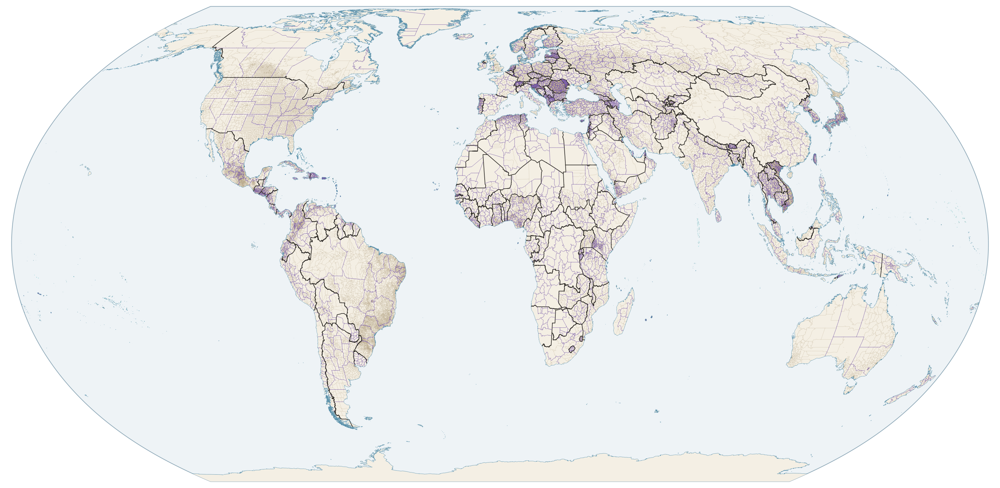
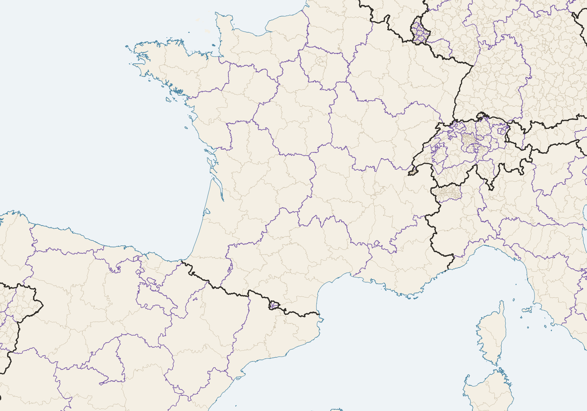
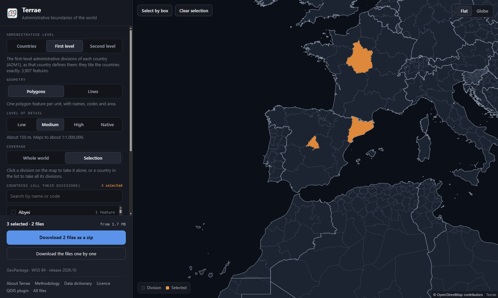
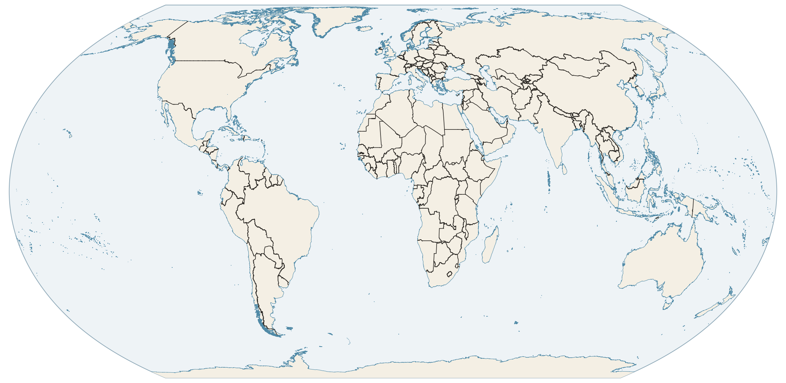
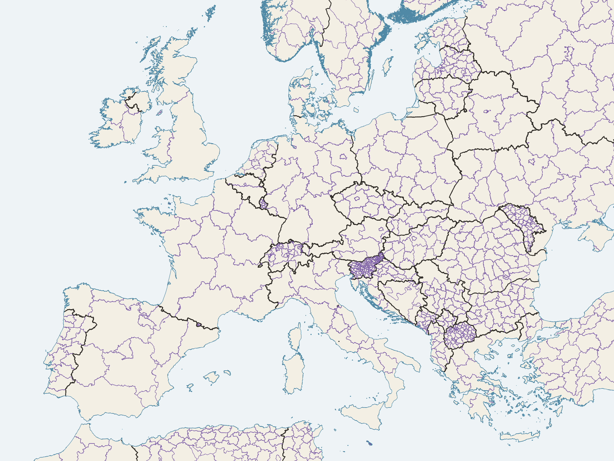

# Terrae

**Ready-to-use administrative boundaries of the whole world, built from OpenStreetMap.** Countries and
territories (ADM0) and each country's first- and second-level administrative divisions (ADM1, ADM2), as that
country defines them: one validated dataset in which every
boundary is drawn once, the three levels fit one another exactly, and every feature carries the codes needed to
join it to other data. Open data, free to download.



**[Open the map downloader](https://p-rubi.github.io/terrae/)** · [Data repository](https://huggingface.co/buckets/geodataset/terrae) ·
[QGIS plugin](https://github.com/p-rubi/world-administrative-boundaries) · [Methodology](docs/methodology.md)

| | |
|---|---|
| **Level 0 (ADM0)** | 255 countries, territories and special areas |
| **Divisions** | As each country defines them: states and counties in the United States, autonomous communities and provinces in Spain, regions and departments in France |
| **Level 1 (ADM1)** | 3,907 features: the first-level administrative divisions of each country |
| **Level 2 (ADM2)** | 50,231 features: the second-level administrative divisions within them |
| **Views of level 0** | Reference partition, de facto view, and an overlay of 35 disputed areas |
| **Geometry** | Polygons, and boundary lines classified as border, internal boundary or coastline |
| **Detail** | Four levels: `native` (the vertices of OpenStreetMap), `high` (about 15 m), `medium` (about 150 m) and `low` (about 1,500 m) |
| **Format** | GeoPackage, WGS 84 (EPSG:4326); the world in one file, or one file per country |
| **Source** | OpenStreetMap planet file of 28 September 2026 |
| **Release** | 2026.10 |
| **Licence** | Open Database License 1.0: free to use, commercial work included, with credit and share-alike |

## What makes it useful

- **Ready to work with.** Clean polygons and lines with names, codes and areas, in standard formats. No
  assembling of relations, no fixing of geometry, no guessing which OpenStreetMap level is the province.
- **Global coverage.** Every piece of land on Earth is in exactly one country, one first-level division and one
  second-level feature, Antarctica included. No gaps and no overlaps, at any level.
- **Alternative territorial representations.** Level 0 comes in three coordinated layers: a *reference* partition
  that follows published rules (a UN position where one exists, otherwise effective control), a *de facto* view of
  the world as it is administered, and an overlay of *disputed areas* that records who administers each area, who
  claims it and on what basis. Choose the view your map needs; the edges are the same in all three.
- **Interoperable.** ISO 3166-1 codes (alpha-2, alpha-3, numeric) where ISO assigns them, the codes in common use
  where it does not (Kosovo), UN M49 identifiers, ISO 3166-2 codes for divisions, Wikidata and OpenStreetMap
  identifiers, and the sovereign state of every territory. Joining statistics from the UN, the World Bank or a
  national office is a one-line join.
- **Validated and consistent.** Every release is checked before publication: valid geometry, exact nesting of the
  three levels, the same features at every level of detail. A country equals the union of its first-level divisions,
  and each of these the union of its second-level divisions, at every level of detail.
- **Boundaries that stay aligned.** The levels of detail are simplified together, so neighbours keep sharing
  their edges and maps at different scales and administrative levels line up.
- **The same lines as OpenStreetMap.** At `native` detail the boundaries are the vertices of OpenStreetMap, and
  the lighter levels stay within a stated tolerance of them, so they sit on OpenStreetMap-based basemaps and data
  instead of drifting away as independently drawn boundaries do.
- **Flexible detail.** Four levels, from the native geometry of OpenStreetMap to versions simplified for
  regional maps, world maps and the web, all generated from the same geometry and checked against it.
- **Boundaries as lines, too.** Each boundary is drawn once and classified: international border, first-level or
  second-level boundary, coastline. Draw borders without coasts, or the opposite.
- **Transparent.** The rules, and the log of every decision the build made, are published as plain tables.
  Releases are versioned, never changed after publication, and every file has a SHA-256 checksum.
- **Free and convenient.** Download the world or a single country from the
  [map downloader](https://p-rubi.github.io/terrae/), by direct link, or from inside QGIS.



*Western Europe at `medium` detail: borders in black, first-level boundaries in purple, second-level boundaries in
brown, coastline in blue. All of them come from the same set of lines.*
## Get the data

**Map downloader:** <https://p-rubi.github.io/terrae/> — choose the administrative level, the level of detail and
the geometry, then take the whole world, whole countries, or single divisions clicked on the map.

[](https://p-rubi.github.io/terrae/)

**Data repository:** <https://huggingface.co/buckets/geodataset/terrae>

```
repository.json                          the releases held and the latest one
releases/2026.10/manifest.json           datasets, levels, entities, file patterns, sizes
adm0/2026.10/   adm1/2026.10/   adm2/2026.10/            medium and low
full/adm0/2026.10/   full/adm1/...   full/adm2/...        high and native, same layout
    world/                               one file per level of detail and geometry, whole world
    places/<detail>/<layer>/<geometry>/<KEY>.gpkg    one file per country (KEY = ISO alpha-3 code)
    tables/                              rules and build logs, CSV
    docs/                                the documents below
    SHA256SUMS
```

Direct links follow the pattern `https://huggingface.co/buckets/geodataset/terrae/resolve/<path>`, for example
[the countries of the world at low detail](https://huggingface.co/buckets/geodataset/terrae/resolve/adm0/2026.10/world/terrae-adm0-2026.10-low-reference-polygons.gpkg)
(9 MB) or
[the second-level divisions of France](https://huggingface.co/buckets/geodataset/terrae/resolve/adm2/2026.10/places/medium/reference/polygons/FRA.gpkg).

The repository carries GeoPackage files. The other formats named in the data dictionary (GeoParquet, GeoJSON,
KML) and the single-file packages are not hosted at present; any GIS converts a GeoPackage to them.

**In QGIS:** the plugin [World Administrative Boundaries](https://github.com/p-rubi/world-administrative-boundaries)
browses this repository, downloads only the countries and divisions you choose and adds them to the map.



## How it is made

In short (the full account is in the [methodology](docs/methodology.md)):

1. **One snapshot.** A complete OpenStreetMap planet file is loaded into PostgreSQL/PostGIS, so every boundary
   describes the same moment. The land itself comes from the coastline of the same file (`osmcoastline`).
2. **Countries.** The boundary relations of the 255 units are assembled and cut to the land. Where they overlap or
   leave land unassigned, published rules decide; contested land is assigned by named rules with their basis.
3. **First level.** For each country, the divisions are chosen by their ISO 3166-2 codes, not by the level number
   OpenStreetMap gives them, which means something different in each country. Land in no division becomes a named
   undivided area.
4. **Second level.** The tier that actually divides the first level of each country is measured country by
   country. Where a country has none, its first-level divisions are carried down, so the level still covers the
   world.
5. **One set of faces.** All the linework is noded together into faces; each face belongs to one second-level
   feature, therefore to one first-level division and one country. Every level and every line is derived from that
   single set, which is why they fit exactly.
6. **Levels of detail.** The faces are simplified together, preserving shared edges and topology.
7. **Checks.** Each release is validated before publication: valid geometry, no overlaps, no gaps, exact nesting
   between levels at every level of detail, identifiers and codes, and checksums of the published files.

Tools: PostgreSQL with PostGIS, osmcoastline, GDAL and QGIS. The build code is not published at present; the
methodology, the rules and the build logs are.



## Documents

- [Methodology](docs/methodology.md): sources, rules, guarantees and known limitations
- [Data dictionary](docs/data-dictionary.md): layers, fields and file names
- [Licence and citation](docs/licence.md)
- [Changelog](docs/changelog.md)

## Limitations worth knowing

- Positional accuracy is that of OpenStreetMap and is not certified. Boundaries are not authoritative or legal
  lines.
- Coverage of the second level depends on OpenStreetMap: some countries have no usable second level in this
  snapshot, and some land is recorded as undivided or unmapped instead of being guessed.
- Only land is covered: no maritime boundaries, territorial waters or exclusive economic zones.
- At `low` detail small second-level divisions lose their shape; use `medium` or finer for second-level work.

## Licence

Terrae is derived from OpenStreetMap, so the data is under the
[Open Database License 1.0](https://opendatacommons.org/licenses/odbl/1-0/), the same licence as its source. You
may use it for any purpose, commercial work included. Credit **© OpenStreetMap contributors; Terrae**, and if you
publish an adapted version of the database, share it under the same licence. Maps and images made from the data can
carry any licence. The documents in this repository are under
[CC BY 4.0](https://creativecommons.org/licenses/by/4.0/). Details and how to cite: [licence](docs/licence.md).

Boundaries, names and designations do not imply any opinion on the legal status of any country, territory or area.

## Contact

Terrae is made and maintained by [p-rubi](https://github.com/p-rubi). Questions, errors found and suggestions:
open an [issue](https://github.com/p-rubi/terrae/issues) or write to geo.prubi@gmail.com.